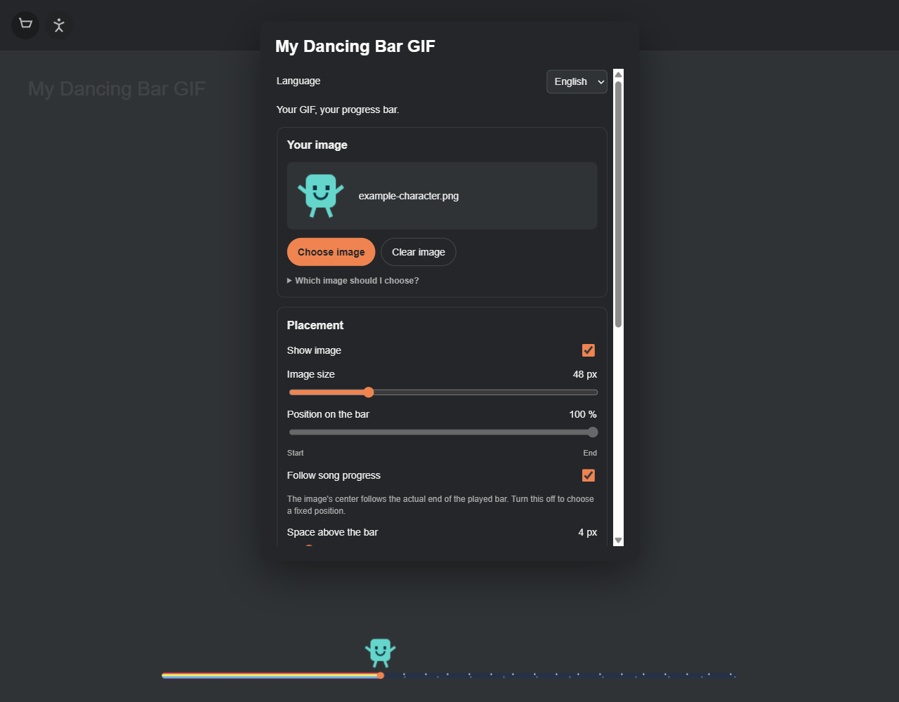

# My Dancing Bar GIF

**Your GIF, your progress bar.** A Spicetify extension by [sykesseb](https://github.com/sykesseb).



*Interface preview with a demonstration image. No character is bundled.*

Upload your own character, place it anywhere on the song progress bar, or let its center follow the actual playback point. Customize the bar with a solid color, rainbow, rainbow with stars, or laser glow. English and Spanish are included.

## Features

- Your own GIF, PNG, WebP or JPG, saved locally. No bundled character and no required image downloads.
- Fixed position slider, image size and gap controls.
- Precise progress tracking, including the beginning/end of a track and seeking. The image center follows the native fill rather than an estimate from the elapsed time.
- Optional sway for still images and an option to hide the image while paused.
- Independent bar customization: color, background, thickness, rainbow, stars and a procedural laser effect.
- Restore your theme's bar at any time.
- English / Español language selector and an accessible settings button in the top bar and profile menu.

## Install

Requires the Spotify **desktop app** with [Spicetify](https://spicetify.app/) already installed. This does not work in Spotify's mobile app.

### Marketplace

Once this repository is indexed by Marketplace, look for **My Dancing Bar GIF** in **Extensions**. A new repository may take time to appear in GitHub search / Marketplace.

### Manual

1. Download `my-dancing-bar-gif.js` from this repository.
2. Put it in your Spicetify `Extensions` folder. Run `spicetify path` if you need to locate your configuration directory.
3. Run:

```text
spicetify config extensions my-dancing-bar-gif.js
spicetify apply
```

## Use

Open **My Dancing Bar GIF** using the dancing-person button in Spotify's top bar or the entry in your profile menu.

1. Choose **English** or **Español**.
2. Click **Choose image / Elegir imagen** and pick your file.
3. Adjust the image size, its fixed position and space above the bar.
4. Enable **Follow song progress / Seguir el progreso de la canción** to center the image above the native playback point. Disable it to use the position slider.
5. Select a bar style and adjust its color and thickness, or retain your existing Spotify theme.

Changes are saved automatically on this computer. Uploaded images do not become part of this repository or get shared with other users.

### Choosing an image

- Use an **animated GIF or animated WebP** for a character that already moves. Animation is retained; this extension does not generate animation or analyze the musical beat.
- A **transparent background is recommended**, but not mandatory. If the file has an opaque background, that rectangle remains visible. This extension does not remove backgrounds.
- Static PNG/JPG/WebP files are accepted. **Sway image** adds a simple movement, which pauses with playback. An animated file's own animation continues unless the image is hidden by **Show image only while playing**.
- Maximum file size: **8 MB**. Maximum dimensions: **4096 × 4096 pixels**. Smaller files generally decode more cheaply.
- Empty margins inside a file affect how the visible character is centered. Crop them from the source image if needed.

### Other bar snippets and themes

The **Current Spotify / theme** option preserves existing styles, including other snippets. Custom bar styles temporarily replace the appearance of this song progress bar, including third-party handles, without uninstalling those snippets. Restoring the theme removes these overrides. Volume controls are not styled.

## Privacy and performance

No network requests, tracking, account requests, audio capture, playlist changes or playback commands. The profile credit link opens GitHub only if you click it. Images use local IndexedDB; small preferences use localStorage. Settings are per Spotify desktop installation and do not sync across devices.

Progress rendering follows the native bar geometry, including seek/drag state. Its rendering loop is capped at 30 Hz, used only when progress tracking or custom bar styling requires it during playback, and stopped while paused or the document is hidden. GIF decoding is handled by Spotify's browser engine; very large animations can still consume resources.

## Compatibility

Developed and checked on **Spotify 1.3.6 / Spicetify 2.46.4, Windows**. Other desktop systems are not yet verified. Future Spotify changes may require selector updates. Spotify's detached mini-player and special fullscreen layouts are not guaranteed.

See [validation and known limits](VALIDATION.md) for the checks performed and how to reproduce the repository checks. GitHub Actions checks JavaScript syntax and the Marketplace package on each push.

Existing images and settings from the early local “Mi monito” version are migrated. The example BMO image is not bundled or reintroduced.

## Uninstall

If installed manually:

```text
spicetify config extensions my-dancing-bar-gif.js-
spicetify apply
```

If installed through Marketplace, remove it there. Uninstalling does not erase the locally saved image and preferences; use **Clear image** before uninstalling if desired.

## Credits

Created by **sykesseb** as a first small, AI-assisted project, built around an app used every day. Implementation developed with assistance from OpenAI Codex. Built with Spicetify, an independent community project; this extension is not affiliated with Spotify.

The combination of a character and a rainbow trail was inspired by the community's [Nyan Cat Progress Bar snippet](https://github.com/spicetify/marketplace/blob/main/resources/snippets.json). This project does not bundle its cat artwork, GIF, or background assets. Bar effects and icon are drawn with CSS/SVG. The laser style is a procedural visual effect; it does not activate Spotify's Star Wars easter egg or bundle its artwork.

Code: [MIT](LICENSE). Uploaded artwork belongs to its respective owners; uploading it locally does not change those rights.

## Español

Extensión para personalizar la barra de reproducción de Spotify con **tu propio GIF o imagen**. Puedes moverlo con un deslizador o hacer que su centro siga el progreso real de la canción. Incluye tamaño, separación, balanceo opcional, idioma español/inglés y estilos de barra: color, arcoíris, estrellas y brillo láser.

En Spotify, abre **My Dancing Bar GIF**, selecciona **Español** y pulsa **Elegir imagen**. Se recomienda un GIF animado con fondo transparente; una imagen con fondo o estática también se acepta. Los archivos y ajustes se guardan en tu computadora. No se incluyen personajes predeterminados.
